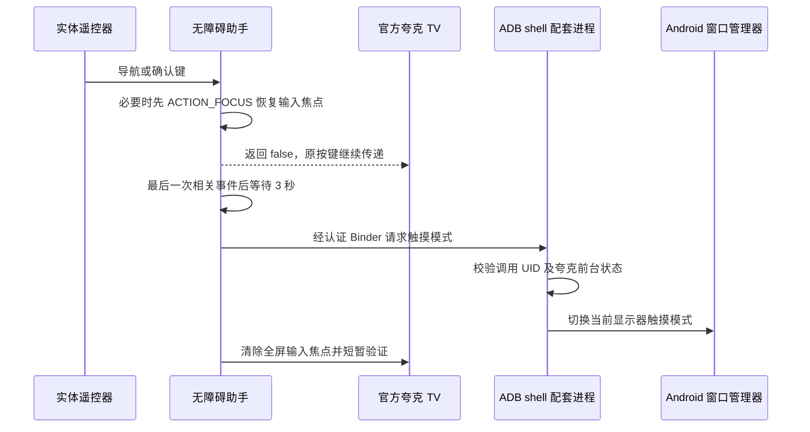

# 架构说明

## 组件

## 为什么分为 APK 和配套进程

普通应用不能直接以 ADB shell 身份操作窗口管理器。无障碍服务负责输入与控件焦点，ADB 启动的 `BinderModeAgent` 只提供经过约束的触摸模式切换。它以 UID 2000 运行，不要求 Root，也没有开机自启能力。

APK 包名为 `local.quark.focushelper`，目标夸克包名为 `com.quark.yun.tv`。配套进程名为 `quark_mode`。APK 没有桌面 Activity。

## 计时与按键

`FocusService` 对导航键、确认键，以及目标应用的窗口和焦点变化重新计时，默认延迟 3000 ms。控制栏收起时可能产生焦点事件，因此延迟从最后一次事件计算。

在真实按键按下时，如果目标窗口没有输入焦点，服务首先恢复之前清除的节点，必要时查找全屏可聚焦节点。框架 `ACTION_FOCUS` 会先退出触摸模式；恢复后返回 `false`，不吞掉原始按键。

只有宽、高均达到根窗口 90% 的可见焦点节点会进入清除流程，避免直接清除较小的进度条控件。代际计数取消已过时的清除操作；短暂重试检查清除结果，并避免自己的清除动作不断重启计时。

## Binder 注册与授权

- `ConfigReceiver` 与 `AgentProvider` 受系统 `android.permission.DUMP` 保护，普通第三方应用不能调用。
- 启动脚本生成随机的 64 位十六进制字符串，分别写入应用私有配置和 shell 所有的 `600` 配置文件。
- Provider 进一步要求调用者 UID 为 2000，认证密钥匹配后接收 Binder，返回助手应用 UID。
- 配套进程仅接受已登记助手 UID 的请求。实际调用系统接口前清除 Binder 调用身份，检查最前台应用和显示器，调用后恢复身份。
- 相同 Binder 的重复注册不重新触发计时。周期重新注册可在助手进程重启后恢复连接。

密钥不在 APK 内置。持有设备 ADB 授权的电脑有能力配置和停止配套进程，这是该工具的信任边界。

## 兼容边界

配套进程依赖 Android 14 隐藏接口，包括 `IWindowManager.setInTouchMode(boolean, int)` 及系统 ContentProvider 注册调用。这些接口随系统版本或厂商实现可能变化，v0.0.1 的启动工具因此只接受 API 34。不能仅提高 manifest 的兼容范围就声称支持新系统。
